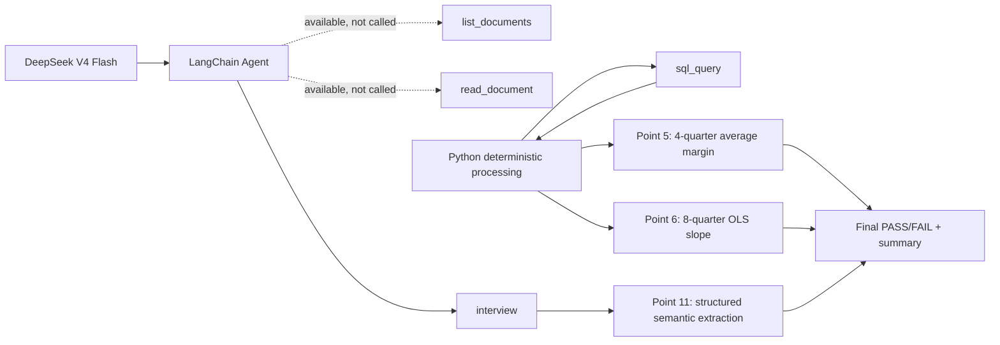
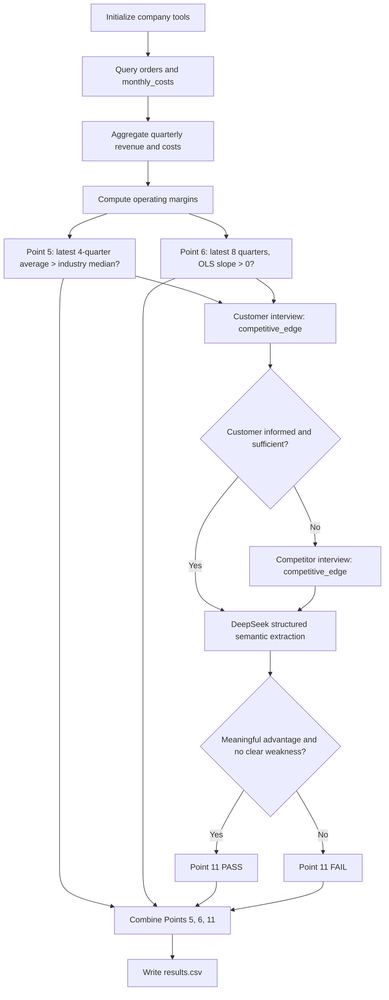

# FTEC5660 Homework 3 — Fisher Investment Analysis Agent

## 1. Project Overview

This project applies Philip Fisher's fifteen-point investment framework to fictional companies using database evidence, interviews, Python calculations, LangChain, and DeepSeek V4 Flash. The selected points are **5 (worthwhile profit margin), 6 (maintaining or improving margins), and 11 (advantage over competitors)**.

## 2. Homework 3 Solution

### 2.1 Point 5 — Worthwhile Profit Margin

Operating margin measures the proportion of revenue left after operating costs:

```text
Operating Margin = (Revenue - Cost of Sales - Selling & Admin - R&D) / Revenue
```

Revenue is aggregated from `orders`; costs are aggregated by quarter from `monthly_costs`; the benchmark is the company's industry row in `industry_medians`. The latest four complete quarters are averaged. **PASS** requires the average to be strictly greater than the industry median; otherwise the result is **FAIL**.

### 2.2 Point 6 — Maintaining or Improving Margins

Point 5 evaluates the level of profitability against peers. Point 6 evaluates direction over time. The latest eight complete quarterly operating margins are sorted chronologically and fitted with an ordinary least squares line against quarter indexes 0 through 7. **PASS** requires a strictly positive slope; zero or negative slope is **FAIL**. This database trend is an observable proxy for maintaining or improving margins; it does not directly reveal management's specific actions.

Evidence comes from `orders` and `monthly_costs`. Python performs aggregation, margin calculations, and regression arithmetic.

### 2.3 Point 11 — Advantage over Competitors

Point 11 uses Fisher's scuttlebutt approach. The LangChain agent first asks a customer about `competitive_edge`. If that response is uninformed or insufficient, it asks a competitor, while respecting the ten-interview company limit.

DeepSeek extracts structured fields (`informed`, categories, exact quotations, meaningful differentiation, weakness/commoditization, verdict, and role). Python validates the structure and applies the final rule. Performance, quality, reliability, delivery, installed base, know-how, customer dependence, switching costs, loyalty or customer return, proprietary technology, and difficult-to-replicate capability may support PASS. Generic praise alone, commodity products, price-only competition, no differentiation, or material weakness supports FAIL. Patents and switching costs are not mandatory.

## 3. Agent Architecture



The four company tools are available to the per-company agent, but the current execution path uses the model-directed `interview` tool for Point 11. `sql_query` is invoked directly by Python for Point 5 and Point 6; `list_documents` and `read_document` are not invoked in this workflow. Python performs all financial arithmetic and applies the fixed rules. The final result contains three verdicts and an evidence summary.



## 4. Public Test Results

Latest production run: **55/60 correct predictions; overall Balanced Accuracy 90.9%**.

| Point | TP | TN | FP | FN | PASS Accuracy | FAIL Accuracy | Balanced Accuracy |
|---|---:|---:|---:|---:|---:|---:|---:|
| 5 | 14 | 6 | 0 | 0 | 100.0% | 100.0% | 100.0% |
| 6 | 11 | 4 | 2 | 3 | 78.6% | 66.7% | 72.6% |
| 11 | 14 | 6 | 0 | 0 | 100.0% | 100.0% | 100.0% |

Balanced Accuracy is `(PASS Accuracy + FAIL Accuracy) / 2`; the overall score is the arithmetic mean of the three point Balanced Accuracy values. The five incorrect classifications in the latest run were `aurel_systems`, `bramble_labs`, `juniper_industries`, `lindale_holdings`, and `northwind_group`, all from Point 6's financial trend rule. Point 6 is intentionally database-only and therefore observes margin direction rather than management intent.

## 5. Task 2 — Reflection on AI Sycophancy and AI Psychosis

AI sycophancy occurs when a model agrees with a convenient interpretation instead of challenging weak evidence. In this project, early semantic classifications treated some statements too conservatively or too generously until the original interview wording and confusion matrices were reviewed. Independent SQL calculations and ground-truth testing were necessary checks.

AI psychosis describes the risk of allowing generated explanations to become accepted as facts through repeated, unsupported assumptions. During development, the first Point 11 prompt rejected several valid performance and know-how statements as generic praise. Reviewing the original customer and competitor responses exposed that error, so the prompt and structured fields were revised without making patents or switching costs mandatory. SQL/Python independently checked every margin and slope, while confusion matrices showed where the model was wrong. Preserving quotations, roles, and validated JSON keeps the final decision tied to evidence.

## 6. Setup and Reproducibility

```bash
python3 -m venv .venv
source .venv/bin/activate
pip install -r requirements.txt
```

Create `.env` locally:

```text
DEEPSEEK_API_KEY=your_api_key
```

Run the public test:

```bash
python3 hw3.py --data-folder public_test
```

The key must never be committed to GitHub. The runner writes `results.csv` with company verdicts, errors, interview counts, and summaries.
